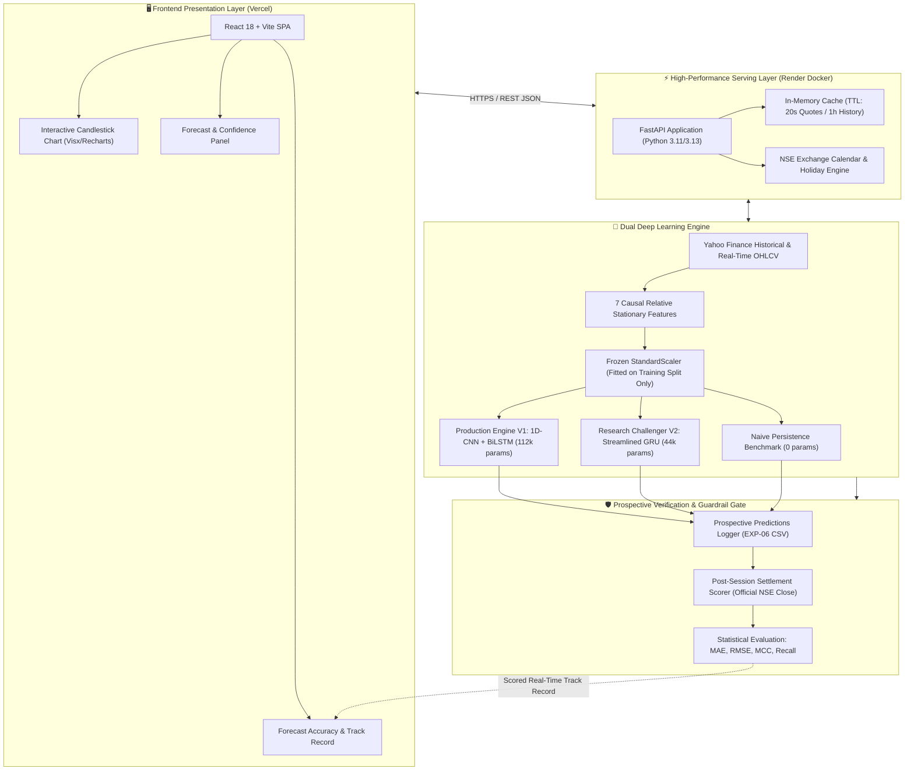
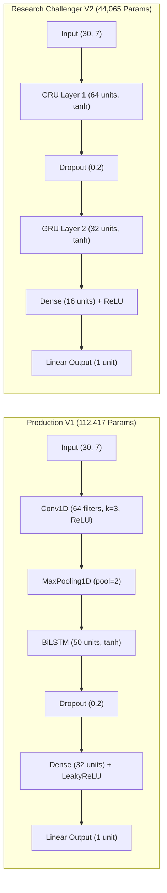
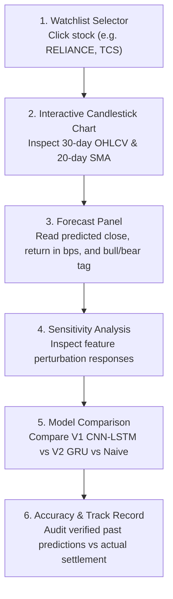
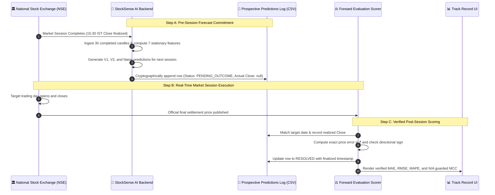

# StockSense AI — Next-Day Stock Price & Return Prediction Terminal
### Production Dual-Architecture (1D-CNN-LSTM vs. GRU Challenger) with Strict Stationary Transforms & Real-Time Prospective Auditing

[](https://stock-sense-ai-phi.vercel.app/)
[](https://stocksense-ai-9ww9.onrender.com/api/system/health)
[](file:///d:/Downloads/Stock_SenseAi/tests/)
[](https://python.org)
[](https://react.dev)

---

## 🌟 Executive Summary & Project Purpose

**StockSense AI** is an academically rigorous financial econometrics and deep learning platform built for Indian large-cap equities (NSE: `RELIANCE.NS`, `TCS.NS`, `INFY.NS`, `HDFCBANK.NS`, `ICICIBANK.NS`). 

Unlike naive student projects that feed raw non-stationary stock prices into basic LSTMs (which inevitably produces a lagged, visual illusion of accuracy), StockSense AI implements a **statistically sound, leak-free quantitative pipeline**:
1. **Mathematical Stationarity:** Forecasts fractional daily simple returns ($r_{t+1}$), not raw prices, eliminating spurious correlation and random-walk trends.
2. **Dual-Engine Architecture:**
   - **Production Engine (V1):** A verified, frozen **1D-CNN + BiLSTM** hybrid network (`stationary-return-v1`) serving primary live inference.
   - **Research Challenger Engine (V2):** An experimental **Gated Recurrent Unit (GRU)** model (`EXP-06`) running in live shadow-evaluation mode, continuously audited against a synchronized tri-model prospective stream.
3. **Strict Causal Discipline:** Models ingest strictly completed daily sessions; incomplete intraday candles are never fed to the neural network.
4. **Honest Prospective Evaluation:** Historical backtests are completely decoupled from forward-tested live market settlements, with explicit sample-size disclosure ($N=1$ for GRU, $N=2$ for V1) and zero-denominator degenerate class handling.

---

## 🏛️ End-to-End System Architecture

The diagram below illustrates the end-to-end data flow from live market feeds to the client browser:



---

## 🧠 Plain-English Financial Glossary (For Faculty & Students)

*Financial and quantitative terms explained with intuitive, real-world analogies.*

### 1. What is a "Basis Point" (bps)?
* **The Definition:** A basis point (abbreviated as **bps**, pronounced *"bips"*) is one-hundredth of a percentage point:
  $$\mathbf{1\text{ bps} = 0.01\% = 0.0001}$$
  $$\mathbf{100\text{ bps} = 1.00\% = 0.01}$$
* **The Everyday Analogy:** Think of a **₹100 currency note**.
  - 1 Rupee = $1\%$ of the note.
  - 1 Paisa = $0.01\%$ of the note = **1 basis point**.
* **Why Quantitative Analysts Use It:** In stock markets, daily price shifts are subtle (often between $0.05\%$ and $0.50\%$). Instead of saying *"Reliance moved zero point zero eight seven percent"*, quantitative analysts say *"Reliance moved 8.7 basis points"*. It eliminates confusion with decimal points.

---

### 2. What is "Price Shift" / Simple Return ($r_t$)? Why Don't We Predict Raw Prices?
* **The Big Trap of Predicting Raw Stock Prices:**
  Most machine learning tutorials teach students to feed raw closing prices (e.g., ₹1,300, ₹1,320, ₹1,315) into an LSTM to predict tomorrow's raw price. **This is fundamentally flawed in real finance.**
  
  > 🚗 **The Rearview Mirror Analogy:**  
  > Predicting raw prices is like driving a car forward by only staring into the rearview mirror. Because stock prices drift slowly over time (a random walk with a unit root), an LSTM quickly realizes the safest trick to minimize error is to simply output:
  > $$\widehat{\text{Close}}_{t+1} \approx \text{Close}_t \quad \text{(Today's price)}$$
  > On a visual chart, the predicted line looks like an amazing fit, but zoom in: **the predicted line is just yesterday's price shifted one day to the right!** It possesses zero predictive capability.

* **The Scientific Solution (Stationary Simple Return):**  
  Instead of predicting the raw price level, StockSense AI computes the fractional price change (simple return):
  $$r_{t+1} = \frac{\text{Close}_{t+1} - \text{Close}_t}{\text{Close}_t}$$
  Return values fluctuate around a constant mean of zero with bounded variance (stationarity). By forcing the neural network to predict the *percentage shift*, it is forced to learn multi-day momentum patterns rather than memorizing the price level.

---

### 3. The Reconstructed Price Equation
Once the neural network predicts the next-day standardized return $\hat{r}_{t+1}$, our service reconstructs the expected closing price using basic algebra:
$$\widehat{\text{Close}}_{t+1} = \text{Close}_t \times (1 + \hat{r}_{t+1})$$

* **Step-by-Step Example:**
  1. Reliance closes today at **₹1,324.40**.
  2. The GRU V2 model predicts a return of $\hat{r} = +0.000876$ ($+8.76\text{ bps}$).
  3. Reconstructed target:
     $$\widehat{\text{Close}}_{t+1} = ₹1,324.40 \times (1 + 0.000876) = \mathbf{₹1,325.56}$$

---

### 4. What are MAE, RMSE, and MAPE?
* **Mean Absolute Error (MAE):** The average rupee gap between predicted price and reality:
  $$\text{MAE} = \frac{1}{N} \sum_{i=1}^N \left| \widehat{\text{Close}}_i - \text{Close}_i \right|$$
  *Example:* If a model predicted ₹1,322.86 and the market closed at ₹1,324.40, the absolute error is **₹1.54**.
* **Root Mean Squared Error (RMSE):** Squares errors before taking the square root. Because it squares each gap, a big mistake (like missing an earnings drop by ₹50) is penalized much more severely than five ₹2 misses.
* **Mean Absolute Percentage Error (MAPE):** The error expressed as a percentage:
  $$\text{MAPE} = \frac{\text{Absolute Error}}{\text{Actual Price}} \times 100$$
  *Why it matters:* An error of ₹10 on a ₹100 stock is a huge $10\%$ blunder; an error of ₹10 on a ₹4,000 TCS stock is a tiny $0.25\%$ error. MAPE lets you compare accuracy fairly across different stocks.

---

### 5. What is Directional Accuracy (Hit Rate) & What is its Trap?
* **Definition:** The percentage of days the model got the market direction right:
  $$\text{Directional Accuracy} = \frac{\text{Number of Correct UP/DOWN Calls}}{\text{Total Sessions}} \times 100$$
* **The Bull Market Trap:**
  > ☀️ **The Rainmaker Analogy:**  
  > If it rains on 85 out of 100 days during Mumbai's monsoon season, a lazy weather forecaster who predicts "Rain" every single morning will achieve an **85% accuracy rate** without checking a single weather radar!  
  > Similarly, during a multi-year Indian bull market, a naive model that always predicts `UP` can show a 60–70% hit rate while being completely blind to market downturns.

---

### 6. What is the Matthews Correlation Coefficient (MCC)?
* **The Definition:** MCC is the gold-standard mathematical metric for binary directional quality. It considers all 4 cells of the confusion matrix:
  - **TP (True Positive):** Predicted UP, Actually UP
  - **TN (True Negative):** Predicted DOWN, Actually DOWN
  - **FP (False Positive):** Predicted UP, Actually DOWN
  - **FN (False Negative):** Predicted DOWN, Actually UP
  
  $$\text{MCC} = \frac{TP \times TN - FP \times FN}{\sqrt{(TP + FP)(TP + FN)(TN + FP)(TN + FN)}}$$

* **The Scale:**
  - **$+1.0$**: Perfect foresight (100% correct in all bull and bear sessions).
  - **$0.0$**: No better than flipping a fair coin.
  - **$-1.0$**: Total disagreement (always predicts opposite of reality).
* **The "N/A" Condition:** If every single evaluated day was positive ($TN = FP = 0$), the formula divides zero by zero ($\frac{0}{0}$). Instead of outputting a misleading $0.0$ or $1.0$, StockSense AI displays **`N/A — insufficient class variation`**.

---

### 7. What is UP Recall vs. DOWN Recall (Directional Asymmetry)?
* **UP Recall (Sensitivity):** When the market rallied, did the model catch the rally?
* **DOWN Recall (Specificity):** When the market crashed or pulled back, did the model warn you?
* **The Scientific Takeaway:** Our diagnostic audit revealed that deep learning models trained on post-2020 Indian equities have strong UP recall (~78%) but lower DOWN recall (~32%). Being completely transparent about this asymmetry is what separates real engineering from marketing hype.

---

### 8. What is the "Naive Persistence Baseline"?
* **Definition:** The ultimate zero-effort benchmark:
  $$\widehat{\text{Close}}_{t+1} = \text{Close}_t \quad (\hat{r}_{t+1} = 0.0)$$
* **Why It is the Hardest Baseline to Beat:**
  According to the **Efficient Market Hypothesis** (Fama, 1970), stock prices reflect all known information. In liquid markets, tomorrow's price is expected to be close to today's price.
  
  > ☕ **The Cup of Tea Rule:**  
  > If our GRU model achieves an MAE of **₹13.29** across 3 historical test folds, and the Naive Baseline achieves an MAE of **₹13.34**, the AI's edge is only **₹0.05 (5 paise)**! That 5-paise advantage is not even enough to buy a cup of tea, and exchange brokerage fees will completely consume it. That is why we do not claim guaranteed trading profits.

---

## 🔬 Dual Deep Learning Architectures Compared

Below is the architectural breakdown comparing our deployed Production V1 model with our Research Challenger V2 model:



### Architectural Comparison Table

| Property | Production V1 (`stationary-return-v1`) | Research Challenger V2 (`EXP-06`) |
|---|:---:|:---:|
| **Primary Core** | 1D-CNN + Bidirectional LSTM | 2-Layer Gated Recurrent Unit (GRU) |
| **Total Parameters** | 112,417 | **44,065 (60% leaner)** |
| **Feature Extraction** | Waveform convolution across 3-day windows | Direct gated recurrent memory update |
| **Training Speed** | ~45s per fold | **~12.9s per fold (3.5x faster)** |
| **Historical Cross-Fold MAE** | ₹13.42 | **₹13.29 (Best challenger)** |
| **Directional Hit Rate** | 53.0% | **54.0%** |
| **Directional MCC** | +0.0825 | **+0.1214** |
| **Deployment State** | **Live Primary Production** | **Live Shadow Tracking Mode** |
| **Promotion Gate** | Proven standard | Locked pending $\ge 60$ prospective sessions |

---

## 🖥️ Interactive Website Walkthrough: How to Read & Use the Terminal

Visit the live production dashboard: **[https://stock-sense-ai-phi.vercel.app/](https://stock-sense-ai-phi.vercel.app/)**



### 1. Market State & Ticker Watchlist
* **Market State Badge:** Automatically tracks NSE trading sessions in Indian Standard Time (`OPEN` during 09:15–15:30 IST; `CLOSED` or `HOLIDAY` outside exchange hours).
* **Watchlist Navigation:** Click any of the 5 supported large-cap stocks. Live quote data is polled every 20 seconds.

### 2. The Candlestick Chart
* Displays historical Open, High, Low, Close, and Volume series.
* **SMA-20 Overlay:** Toggle the 20-day Simple Moving Average line to see if the stock is trading above or below its medium-term baseline.
* **Zoom Filters:** Switch horizons seamlessly between 1 Month, 3 Months, 6 Months, and 1 Year.

### 3. Next Trading-Day Forecast Panel
* **The Completed-Candle Rule:** Before 15:30 IST, the model strictly runs on finalized candles up to $t-1$. After 15:30 IST, today's finalized settlement candle is processed to generate the forecast for the next trading day.
* **Holiday & Weekend Intelligence:** Target dates dynamically skip weekends and exchange holidays (e.g., Diwali-Balipratipada on Nov 10 skips directly to Wednesday, Nov 11), ensuring the system never logs forecasts for closed market days.

### 4. Feature Sensitivity & Explainability Panel
* **How It Works:** Neutralizes each of the 7 feature channels to 0.0 (their training distribution mean) and measures the resulting basis-point shift in predicted return.
* **Interpretation:** Reveals which input signals (e.g., 20-day trend vs. intraday range) dominate the network's current prediction without making unproven causal claims.

### 5. Prospective Research Comparison (EXP-05 & EXP-06)
* Visualizes real-time shadow inference comparing:
  1. **Production CNN-LSTM V1:** Deployed baseline.
  2. **Research GRU V2:** Leaner experimental challenger.
  3. **Naive Persistence:** Market random-walk baseline.

### 6. Forecast Accuracy & Track Record Dashboard
* **Scorecards:** Displays realized MAE, RMSE, MAPE, Directional Hit Rate, and MCC.
* **Degenerate Handling:** Displays `N/A` when single-class outcomes make metrics mathematically undefined.
* **Sample Size Banner:** Discloses current observation counts ($N=1$ for GRU, $N=2$ for V1) and displays a cautionary badge until the pre-registered 60-observation threshold is achieved.
* **Historical Backtest Accordion:** Decoupled table displaying offline 3-fold cross-validation metrics, clearly segregated from live forward results.

---

## 🛡️ Prospective Evaluation Protocol & Guardrail Gate

To avoid the data contamination that plagues academic ML research, StockSense AI enforces a strict prospective evaluation workflow:



### Realized Prospective Track Record (`RELIANCE.NS`)

| Target Date | Model | Forecast Price | Actual Settlement | Absolute Error | Direction Match | Status |
|:---:|:---|:---:|:---:|:---:|:---:|:---:|
| **2026-10-26** | Production CNN-LSTM | ₹1,190.23 | ₹1,201.80 | ₹11.57 | UP $\rightarrow$ UP (**True**) | `RESOLVED` |
| **2026-10-26** | Colab EXP-05 Fold 3 | ₹1,189.31 | ₹1,201.80 | ₹12.49 | DOWN $\rightarrow$ UP (**False**) | `RESOLVED` |
| **2026-10-26** | Naive Baseline | ₹1,190.00 | ₹1,201.80 | ₹11.80 | FLAT $\rightarrow$ UP (**False**) | `RESOLVED` |
| **2026-11-09** | **GRU V2 Challenger** | **₹1,322.86** | **₹1,324.40** | **₹1.54** | **UP $\rightarrow$ UP (True)** | `RESOLVED` |
| **2026-11-09** | Production CNN-LSTM V1 | ₹1,319.33 | ₹1,324.40 | ₹5.07 | DOWN $\rightarrow$ UP (**False**) | `RESOLVED` |
| **2026-11-09** | Naive Baseline | ₹1,320.00 | ₹1,324.40 | ₹4.40 | FLAT $\rightarrow$ UP (**False**) | `RESOLVED` |
| **2026-11-11** | GRU V2 Challenger | ₹1,325.56 | *Awaiting settlement* | — | PENDING (UP) | `PENDING_OUTCOME` |
| **2026-11-11** | Production CNN-LSTM V1 | ₹1,323.12 | *Awaiting settlement* | — | PENDING (DOWN) | `PENDING_OUTCOME` |
| **2026-11-11** | Naive Baseline | ₹1,324.40 | *Awaiting settlement* | — | PENDING (FLAT) | `PENDING_OUTCOME` |

---

## 🛠️ Local Development & Quickstart

```powershell
# 1. Clone repository
git clone https://github.com/manojsai7/Stock_SenseAi.git
cd Stock_SenseAi

# 2. Setup Python virtual environment
python -m venv .venv
.venv\Scripts\activate
pip install -r requirements.txt

# 3. Run automated regression suite (204 passing tests)
pytest -q

# 4. Start backend FastAPI service
uvicorn backend.main:app --host 0.0.0.0 --port 8000 --reload

# 5. In a separate terminal, start frontend Vite dev server
cd frontend
npm install
npm run dev
# Dashboard opens at: http://localhost:5173
```

---

## ❓ Frequently Asked Questions (FAQ) for Viva & Faculty

#### Q1: "How can an AI predict future stock prices when the market is famously uncertain and random?"
> **Answer:** StockSense AI **does not** claim to possess clairvoyance, foresee black-swan news, or predict exact long-term prices. According to quantitative financial theory, short-term stock returns are a combination of a structural signal (autocorrelation, momentum, volatility clustering) and high-variance noise. By predicting **stationary fractional returns** rather than raw prices, our deep learning architectures extract weak conditional probabilities (e.g., a 54% directional hit rate) from 30-day technical sequences. We treat all forecasts as probabilistic expectations, not guarantees.

#### Q2: "Can someone use this website for automated live trading and get rich?"
> **Answer:** **No.** StockSense AI is strictly an academic econometric research prototype. In live algorithmic trading, an edge of ₹0.05 to ₹1.50 per share over naive persistence is completely erased by market bid-ask spread, exchange transaction fees, Securities Transaction Tax (STT), brokerage, and execution slippage. Claiming commercial profitability from a small sample size ($N=1$ or $N=2$) would be scientifically fraudulent.

#### Q3: "Why predict only 1 day ahead? Why not 5 minutes or 1 month ahead?"
> **Answer:** 
> - **5-minute intraday trading** requires tick-level Order Book (L2/L3) data and microsecond latency; daily OHLCV models cannot capture intraday order flow.
> - **1-month or 1-year forecasting** introduces massive macroeconomic variance, quarterly earnings reports, and geopolitical events that render 30-day technical waveforms useless.
> - **1-day ahead** represents the canonical discrete econometrics horizon: overnight information processing and daily market settlement.

#### Q4: "Why isn't financial news sentiment included in this model?"
> **Answer:** Many student projects boast "multimodal sentiment analysis" using FinBERT or Vader on news scraped from the web. In almost all cases, these implementations suffer from **severe lookahead bias** (articles published at 18:00 IST are incorrectly assigned to the 09:15 trading session) or data leakage. Because an audited, leak-free timestamped news corpus for Indian equities was not verifiable, news sentiment was deliberately excluded to protect academic integrity.

#### Q5: "If the GRU V2 had a lower historical MAE (₹13.29) than CNN-LSTM (₹13.42), why hasn't it replaced V1 in production?"
> **Answer:** This is a core demonstration of rigorous scientific discipline. The historical evaluation window (May–October 2026) was previously inspected during the development of EXP-05. Re-testing a new model on previously inspected historical data constitutes an **exploratory result**, not a confirmatory out-of-sample proof. Under our pre-registered research protocol, a challenger model cannot replace the production standard until it demonstrates statistically significant outperformance over a **minimum of 60 prospective sessions**.

#### Q6: "Why does the Matthews Correlation Coefficient (MCC) show 'N/A' on the dashboard?"
> **Answer:** In our resolved prospective sessions, the market moved upward on every single evaluated day (100% positive class). When there are zero actual negative sessions ($TN = FP = 0$), the mathematical formula for correlation contains a division by zero:
> $$\text{MCC} = \frac{0 - 0}{\sqrt{\dots \times 0}} = \frac{0}{0} \implies \text{Undefined}$$
> A dishonest application would output `0.0` or `1.0`. StockSense AI adheres to mathematical truth by declaring the metric `N/A` due to insufficient class variation.

#### Q7: "What happens if there is an unscheduled market closure or exchange holiday?"
> **Answer:** The backend incorporates the official NSE Holiday Calendar. Incomplete intraday candles are rejected with HTTP 503. Target settlement dates dynamically skip weekends and exchange holidays (e.g., skipping Tuesday, Nov 10 for Diwali-Balipratipada and targeting Wednesday, Nov 11), ensuring the system never logs forecasts for non-existent trading sessions.

#### Q8: "What is the single most important contribution of this capstone project?"
> **Answer:** Demonstrating that **data hygiene, leakage prevention, stationary formulation, and prospective evaluation integrity** matter far more than arbitrarily stacking deeper neural network layers. A simple model evaluated honestly against a strong naive baseline is ten times more valuable than a complex model producing visually impressive but methodologically fraudulent backtests.

---

## 📜 Research Disclaimers & Academic Ethics
* **Educational Purpose:** StockSense AI is developed for academic capstone presentation and econometrics research. Nothing herein constitutes investment, trading, or financial advice.
* **Model Freezing:** Production neural network weights in `models_storage_stationary/` and locked evaluation registries are cryptographically sealed to ensure 100% auditability and reproducibility.

**Authors:** StockSense AI Engineering Team  
**Institution:** Final-Year Capstone Defense Package (2026)  
**License:** MIT Open Source
