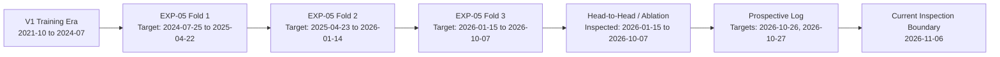

# StockSense AI V2 — EXP-06 Holdout Design & Data Inspection Timeline

**Date:** 2026-11-06  
**Symbol:** `RELIANCE.NS`  
**Document Status:** Locked Pre-Training Design Protocol  
**Purpose:** Establish chronological historical inspection boundaries, evaluate untouched holdout feasibility, and pre-register partitioning rules for V2 evaluation.

---

## 1. Project-Wide Inspection Timeline

To prevent snooping bias and data leakage, all historical experimental runs, prospective logs, and validation sets were audited to identify which dates have already influenced model or feature selection.

### Complete History of Inspected Observations

| Experiment / Milestone | Target Date Range | Number of Target Sessions | Purpose & Usage | Inspection Status |
| :--- | :--- | :---: | :--- | :--- |
| **V1 Initial Development** | 2021-10-07 to 2024-07-24 | ~690 | V1 CNN-LSTM model training & scaler estimation | **Heavily Inspected** |
| **EXP-05 Fold 1** | 2024-07-25 to 2025-04-22 | 184 | Model comparison (CNN-LSTM, Ridge, Logistic, Naive) | **Inspected** |
| **EXP-05 Fold 2** | 2025-04-23 to 2026-01-14 | 184 | Sequential out-of-sample temporal cross-validation | **Inspected** |
| **EXP-05 Fold 3** | 2026-01-15 to 2026-10-07 | 184 | Benchmark evaluation fold for EXP-05 report | **Heavily Inspected** |
| **Head-to-Head Evaluation** | 2026-01-15 to 2026-10-07 | 184 | Production vs Colab model comparison (`predictions_head_to_head_RELIANCE_NS.csv`) | **Heavily Inspected** |
| **Feature Ablation Study** | 2026-01-15 to 2026-10-07 | 184 | Window permutation & mean neutralization on Fold 3 | **Heavily Inspected** |
| **Prospective Prediction Log** | 2026-10-26 to 2026-10-27 | 2 | Forward logging (`prospective_predictions_log.csv`) | **Inspected** |
| **Sprint 1 & 2 Audits** | 2021-10-07 to 2026-10-26 | All available | Zero-volume and incomplete candle audit | **Inspected through 2026-11-06** |

---

## 2. Quantitative Assessment of Untouched Holdout Feasibility

### Principle of Virgin Evidence
A core quantitative requirement of StockSense AI V2 is that model evaluation must never be reported on data that has already been inspected to guide architectural decisions, loss functions, calibration thresholds, or feature designs.

1. **EXP-05 Fold 3 Cannot Serve as an Untouched Holdout:**
   - Fold 3 (targets: 2026-01-15 to 2026-10-07) was repeatedly examined during EXP-05 reporting, directional accuracy recalculations, threshold tuning, and feature ablation studies.
   - Relabeling Fold 3 as an "untouched virgin holdout" would constitute severe data snooping. Fold 3 is strictly historical development evidence.
2. **Current Available Data Post-EXP-05:**
   - In `data/processed/RELIANCE_NS_processed.csv`, the dataset extends up to `2026-10-26`.
   - After excluding the unconfirmed session of `2026-10-26`, the candidate data terminates at `2026-10-23`.
   - Sessions between EXP-05 Fold 3 end (`2026-10-07`) and the candidate cutoff (`2026-10-23`) count exactly **12 trading sessions**.
3. **Statistical Power Requirement:**
   - The preregistered evaluation protocol mandates a minimum of **60 eligible target observations** for a valid holdout test to provide sufficient statistical power for paired moving-block bootstrap and directional MCC evaluation.
   - 12 sessions $\ll$ 60 sessions.
4. **Definitive Finding:**
   - **Adequate untouched historical observations do NOT exist in the recovered dataset.**
   - We refuse to fabricate a synthetic holdout, truncate training data artificially to mimic an untouched holdout, or disguise EXP-05 Fold 3 as virgin data.

---

## 3. Two-Tier Holdout Architecture

To maintain complete methodological integrity, StockSense AI V2 distinguishes between two distinct evaluation tiers:

### Tier 1: V2-Only Locked Historical Holdout (When Authorized Data is Available)
If a fresh, extended historical dataset covering at least 60 finalized sessions past the inspection boundary (`2026-11-06`) is acquired from an authorized exchange feed:
- **Training Cutoff:** Established strictly before the holdout start.
- **Validation Blocks:** 100 targets preceding holdout, used strictly for hyperparameter selection and early stopping.
- **Final Holdout Window:** Minimum 60 contiguous, finalized trading sessions.
- **Rules:**
  - Scalers fit strictly on training partitions; never on validation or holdout data.
  - Hyperparameters, architecture choices, and calibration thresholds fixed prior to touching holdout.
  - Holdout scored exactly once.

### Tier 2: Prospective Forward Evaluation Stream (Production Standard)
The ultimate standard of evidence for StockSense AI V2 remains **genuinely prospective forward evaluation**:
- **Protocol:**
  1. Forecast generated after 16:00 IST for completed session $t$, predicting target $t+1$.
  2. Cryptographic hash of model checkpoint, input data, and predicted return/price committed to append-only log before market open on $t+1$.
  3. Actual settlement prices retrieved from official NSE Bhavcopy after market close on $t+1$.
  4. Direction, return error, and price error resolved.
- **Target Evidence Goal:** **60 to 100 finalized prospective sessions**.
- **Promotion Threshold:** Consistent statistical superiority over Naive persistence and Ridge baselines across prospective sessions with paired bootstrap 95% confidence intervals excluding zero.

---

## 4. Partitions & Split Specification for EXP-06

When candidate data is partitioned under the standard 3-fold chronological development scheme:

| Partition Block | Minimum Training Samples | Validation Block | Development Test Block | Purpose |
| :--- | :---: | :---: | :---: | :--- |
| **Fold 1** | $\ge 500$ sessions | 100 sessions | 100 sessions | Baseline & Recurrent comparison |
| **Fold 2** | $\ge 600$ sessions | 100 sessions | 100 sessions | Temporal stability verification |
| **Fold 3** | $\ge 700$ sessions | 100 sessions | 100 sessions | Development challenger benchmark |

- **Window Size:** 30 completed daily sessions ($t-29$ through $t$).
- **Features:** Seven stationary features in production order (`return_1d`, `return_5d`, `return_20d`, `intraday_return`, `hl_range_ratio`, `close_to_ma20`, `volume_ratio`).
- **Target:** Simple one-step forward return: $\frac{\text{Close}_{t+1}}{\text{Close}_t} - 1$.
- **Random Seeds:** 42 and 123 for all neural stochastic weight initializations.

